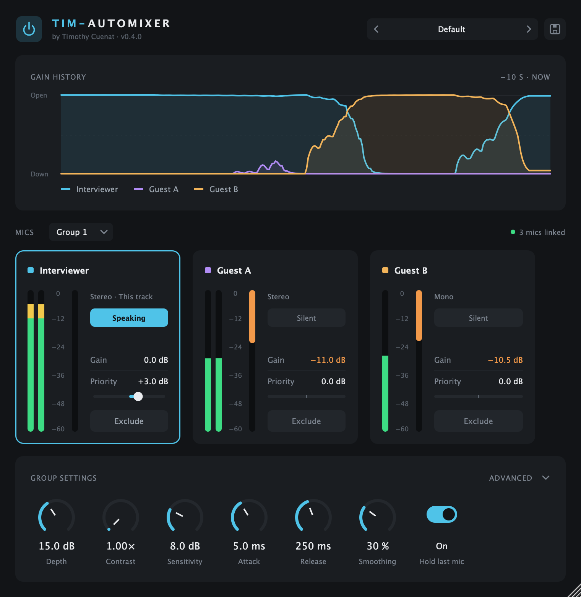
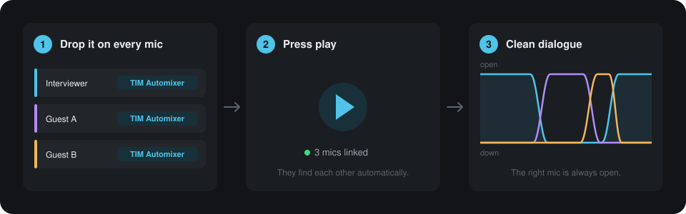
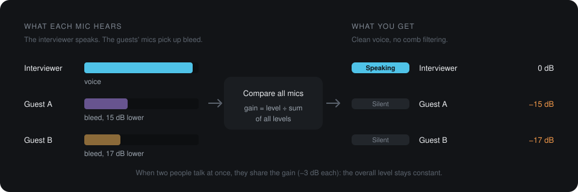

<div align="center">


# TIM-Automixer

### Drop it on every mic. Press play. Done.

Clean, natural dialogue from every lavalier — automatically.<br>
No gates to tune, no volume rides, no comb filtering.

<br>

<a href="https://github.com/timothycuenat/automixer/releases/latest/download/TIM-Automixer-macOS.pkg"></a>
&nbsp;
<a href="https://github.com/timothycuenat/automixer/releases/latest/download/TIM-Automixer-Windows-Setup.exe"></a>

**[Website](https://timothycuenat.github.io/automixer/)** &nbsp;·&nbsp; **[All releases](https://github.com/timothycuenat/automixer/releases)**

<br>



</div>

<br>

## As simple as it gets



No routing and no sidechain: every instance finds the others on its own. In post-production, turn on **Lookahead** in *Advanced* for the most precise result.

## Why it works

Every voice also reaches the other mics, later and quieter. That bleed makes dialogue hollow and phasey, and a gate can't fix it: a voice moves over about 30 dB, while bleed sits only 10–20 dB below it.

TIM-Automixer compares the mics with each other, the way your eyes do on the waveforms.



## What you get

| | |
|---|---|
| **Gain sharing** | The speaker stays open. When two people talk at once, they share the gain and the overall level stays constant. |
| **Linked instances** | One instance per track, up to 8 mics per group and 16 groups per project. |
| **Voice-focused detection** | Listens to 150 Hz – 5 kHz and learns each mic's room noise. |
| **No added latency** | Ready for live use by default. For post-production, turn on Lookahead in *Advanced*: the mic opens just before the first word and your host compensates the delay. |
| **Silence Dip** | Optional, in *Advanced*: when nobody talks, every mic goes down a little, so room noise drops between phrases. |
| **Natural sound** | Smoothing keeps voices steady, and Hold last mic keeps the room tone during pauses. |
| **Depth & Contrast** | Stay gentle and airy, or push bleed further down in difficult rooms. |
| **Live view** | Gain history, meters and a *Speaking* light for each mic. |
| **Presets** | 11 factory presets for interviews, panels, conferences and stages, plus your own. |

## Install

1. **Download** the installer for your system with the buttons above.
2. **Run it**, then restart your audio or video software.
3. **Search for "T-AUTOMIX"** in the effects list and put the plugin first on every mic track.

Use the same format (AU or VST3) on every track of a conversation: AU and VST3 instances can't link with each other.

<details>
<summary><strong>macOS says the installer can't be opened</strong></summary>
<br>

Right-click the file, then choose **Open** and **Open** again.

If your software doesn't list the plugin after installing, paste this in the Terminal and restart the software:

```bash
sudo xattr -dr com.apple.quarantine "/Library/Audio/Plug-Ins/Components/TIM-Automixer.component" "/Library/Audio/Plug-Ins/VST3/TIM-Automixer.vst3"
```
</details>

<details>
<summary><strong>Windows shows "Windows protected your PC"</strong></summary>
<br>

Click **More info**, then **Run anyway**. To uninstall the plugin, go to *Settings → Apps*.
</details>

<details>
<summary><strong>I'd rather install it by hand</strong></summary>
<br>

Download the [macOS .zip](https://github.com/timothycuenat/automixer/releases/latest/download/TIM-Automixer-macOS.zip) or the [Windows .zip](https://github.com/timothycuenat/automixer/releases/latest/download/TIM-Automixer-Windows-VST3.zip). Each one includes an `INSTALL.txt` file with the steps.
</details>

<br>

<div align="center">
<sub>Designed by <strong>Timothy Cuenat</strong>, sound engineer, photographer and filmmaker.<br>
Inspired by Dan Dugan's gain-sharing automixer. Built with <a href="https://juce.com">JUCE</a>.</sub>
</div>
